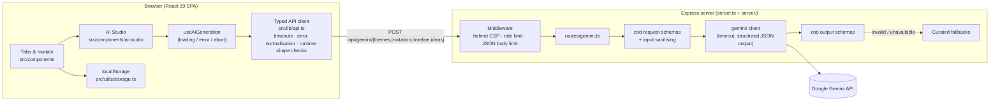

# Fête — Celebration & Event Planner

Fête helps hosts plan birthdays, weddings, showers, anniversaries, office parties and dinner parties. It pairs the usual planning tools (guest list, budget, checklist, vendors, day-of schedule) with an **AI Studio** powered by Google Gemini. The AI Studio drafts themes, invitations, run-of-show timelines and menu, décor and activity ideas, and you can edit every suggestion before saving it to your event.

## The problem

Planning a celebration usually means juggling a spreadsheet for the budget, a notes app for the guest list, a group chat with vendors and a blank page for the invitation wording. Hosts who aren't professional planners also get stuck on the creative parts: picking a cohesive theme, writing invitation copy and working out when the toasts should happen.

Fête keeps all of that in one place and uses AI to get you past the blank page. **Every AI result is a draft.** You review and tweak it, then apply it to the real event data: tasks, timeline, invitation and theme.

## Features

| Problem statement | What Fête does |
| --- | --- |
| **AI-powered themes** | Generates three theme concepts, each with a colour palette, décor ideas, playlist vibe, attire guidance and a signature touch. You can tweak a concept and apply it to the event (palette, description, music and attire are saved), or send its décor straight to the checklist. |
| **Custom invitations** | Drafts an invitation or thank-you note in one of four tones. You can edit the text in place, switch between four card styles (Floral, Champagne, Midnight, Minimalist), preview the card personalised for a specific guest, copy it as text, **print or save it as PDF**, or **email your guests** (a `mailto:` link that BCCs attending and pending guests, so addresses stay private). |
| **Day-of timelines** | Generates a run-of-show for your start and end times and key moments. You can edit any milestone inline, then replace or append to the event's Day-of Schedule. New items get fresh ids, so they never collide with existing entries. |
| **Menu, décor and activities** | Suggests menu courses, décor accents with cost estimates, and party games. You can save the menu to the event, add activities to the schedule (with times spread across the event window), or turn décor into checklist tasks due about a month before the event. |
| **Budget tracking** | Budget vs. actual per expense category, with payment status. |
| **Guest lists** | RSVP tracking, plus-ones, dietary needs, groups and tables, and CSV export. AI prompts use the real headcount (attending guests plus their plus-ones). |
| **Vendor management** | Vendor contacts, quotes and booking status by category. |
| **Tasks / checklist** | A phase-based to-do list, from two months out to after the event. |

Events are saved in the browser (`localStorage`), so no account is needed. Several sample events are included to explore the app.

## Architecture



- **Client.** A Vite-built React SPA. The AI Studio is split into one component per tool (`themes/`, `invitations/`, `timeline/`, `ideas/`) plus shared UI. All network access goes through `src/lib/api.ts`. Pure domain logic lives in `src/lib/*.ts`: request building, headcount, mapping AI output to tasks and milestones, unique ids, time maths, and invitation text and `mailto:` building. React components stay thin.
- **Server.** `server.ts` loads validated config and starts the Express app from `server/`. The server is split into modules: `routes/`, `schemas.ts` (zod), `middleware/` (security headers, rate limiting, validation, error handling), `gemini/` (client and generation with timeout), `prompts.ts` and `fallbacks.ts`. If Gemini is unavailable, times out or returns invalid output, the endpoint answers with curated content, so the app works without an API key.

### API contract

All endpoints are `POST`, take JSON and respond with `{ "success": true, "<key>": ... }`.

| Endpoint | Request (key fields) | Response key |
| --- | --- | --- |
| `/api/gemini/themes` | `occasion, guestCount, budget, vibe, notes` | `themes: AITheme[]` |
| `/api/gemini/invitation` | `eventTitle, occasion, hostName, date, time, location, theme, tone, extraDetails, type` | `invitation` |
| `/api/gemini/timeline` | `eventTitle, occasion, startTime, endTime, guestCount, vibes, keyMoments` | `timeline: TimelineEvent[]` |
| `/api/gemini/ideas` | `occasion, guestCount, budget, theme, dietary, ageGroup` | `ideas: { decor, menu, activities }` |

The TypeScript types for these payloads (`ThemesRequest`, `InvitationResponse` and so on) live in `src/types/index.ts`.

## Tech stack

- **Frontend:** React 19, TypeScript, Vite, Tailwind CSS 4, `motion`, `lucide-react`, `canvas-confetti`
- **Backend:** Node and Express 4, `@google/genai`, `zod`, `helmet`, `express-rate-limit`, `dotenv`
- **Tooling:** Vitest, Testing Library, jsdom, Supertest, `@vitest/coverage-v8`, `tsx`

## Getting started

Prerequisites: Node 20+ (or Bun) and, optionally, a Gemini API key.

```bash
# 1. Install dependencies
bun install        # or: npm install

# 2. Configure environment
cp .env.example .env
#    then set GEMINI_API_KEY in .env (optional: without it, curated suggestions are served)

# 3. Run the dev server (Express + Vite middleware with HMR)
npm run dev        # http://localhost:3000
```

For production, run `npm run build`, then start with `NODE_ENV=production npm start`. Express serves `dist/` and the API from one process.

Optional server settings (validated at boot): `PORT`, `GEMINI_MODEL`, `GEMINI_TIMEOUT_MS`, `RATE_LIMIT_WINDOW_MS`, `RATE_LIMIT_MAX`, `TRUST_PROXY`.

## Scripts

| Script | What it does |
| --- | --- |
| `npm run dev` | Starts the Express server with Vite middleware (HMR) |
| `npm run build` | Production build of the client into `dist/` |
| `npm start` | Starts the server (set `NODE_ENV=production` to serve `dist/`) |
| `npm run lint` | Type-checks the whole project (`tsc --noEmit`) |
| `npm test` | Runs the test suite once (Vitest) |
| `npm run test:watch` | Runs Vitest in watch mode |
| `npm run test:coverage` | Runs the tests with V8 coverage |
| `npm run check` | Type-check, then tests, then build (the CI gate) |

## Security

- **The API key stays on the server.** The browser only talks to `/api/gemini/*` on our own origin. `GEMINI_API_KEY` is read on the server and is never bundled into client code.
- **Input validation.** Every request body is checked against a zod schema (types, enums, length and number limits). Free text is sanitised before it goes into a prompt: control, invisible and delimiter characters are stripped, which reduces the risk of prompt injection.
- **Output validation, twice.** Model output is checked against zod output schemas on the server. The client checks it again at runtime (`src/lib/aiResponseParsers.ts`) before anything reaches React state.
- **Rate limiting and a small body-size limit** on the API routes.
- **Security headers** via Helmet, including a strict Content-Security-Policy in production (scripts only from our own origin), `frame-ancestors 'none'`, and HSTS in production. API responses are marked `no-store`.
- **Resilient client.** Requests time out (30 s), are cancelled when a component unmounts or a newer request replaces them, and every failure becomes one typed `ApiError` with a friendly message.
- **Privacy.** Event data stays in your browser. Saved data is validated when read back. "Email guests" puts addresses in BCC.

## Accessibility

- AI Studio tools use the WAI-ARIA **tabs** pattern (`tablist`, `tab`, `tabpanel` with `aria-selected` and `aria-controls`).
- Every form control has a label linked to it. Segmented choices use `aria-pressed`, and the card-style picker is a `radiogroup`.
- AI errors appear in a `role="alert"` banner with a "Try again" button. The "Copied!" confirmation is announced with `aria-live`. Generate buttons set `aria-busy` while working.
- Decorative icons and emoji are hidden from screen readers. Inline-editable timeline fields have descriptive `aria-label`s.
- Shared, accessible UI building blocks (modal with focus trap, form fields, live region) live in `src/components/ui/`.

## Testing

```bash
npm test                 # everything
npm run test:coverage    # with coverage
npx vitest run src/lib   # just the pure client logic
```

- **Pure logic** (`src/lib/*.test.ts`): request builders, headcount, unique ids, time maths, décor due dates, activity scheduling, timeline merging, invitation text and `mailto:` encoding, and response parsers.
- **API client** (`src/lib/api.test.ts`): uses a mocked `fetch` to cover success, non-2xx responses, network failures, invalid JSON, shape mismatches, timeouts and cancellation.
- **Hooks** (`useAiGeneration.test.ts`): uses `renderHook` to cover the loading, success and error transitions, replaced requests, `cancel()` and abort on unmount.
- **Components** (`AiStudioTab.test.tsx`): renders the tab with a mocked API, then checks tool switching, theme generation, error display, timeline import, invitation personalisation, card style, email, print and save.
- **Server** (`server/**/*.test.ts`): uses Supertest for routes, validation, rate limiting, config, sanitising and fallbacks.

## Project structure

```
.
├── server.ts                    # Entry: load config, build app, start server
├── server/                      # Express app (modular)
│   ├── app.ts                   # App factory: middleware + routes
│   ├── config.ts                # zod-validated environment config
│   ├── routes/gemini.ts         # /api/gemini/* endpoints (declarative)
│   ├── schemas.ts               # zod request & output schemas
│   ├── sanitize.ts              # Prompt-safe text normalisation
│   ├── prompts.ts / fallbacks.ts
│   ├── gemini/                  # Gemini client, generation with timeout, response schemas
│   └── middleware/              # security headers, rate limit, validation, errors
├── src/
│   ├── App.tsx / main.tsx
│   ├── types/index.ts           # Domain + AI request/response types
│   ├── lib/                     # Pure, tested client logic
│   │   ├── api.ts               # Typed fetch client (timeouts, ApiError)
│   │   ├── aiResponseParsers.ts # Runtime shape checks for AI responses
│   │   ├── aiStudio.ts          # Event <-> AI payload mapping
│   │   ├── invitation.ts        # Default draft, text, personalise, mailto
│   │   ├── guests.ts            # Headcount, invitable emails
│   │   ├── ids.ts / time.ts     # Unique ids, clock and date maths
│   ├── components/
│   │   ├── tabs/                # Overview, Guests, Budget, Tasks, Vendors, Timeline, AiStudioTab
│   │   ├── ai-studio/           # AI Studio: one folder per tool + hooks/ + shared/
│   │   ├── modals/              # Create/edit dialogs
│   │   └── ui/                  # Accessible primitives
│   ├── hooks/                   # App-level hooks
│   ├── utils/                   # storage, confetti, stats
│   └── data/sampleEvents.ts     # Demo celebrations
└── vitest.config.ts
```
